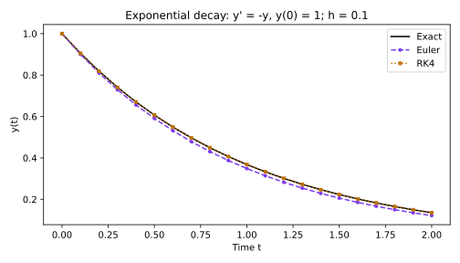

# Scientific computing in Python and MATLAB

A mathematical computing portfolio by **John Adu-Poku**, beginning with reproducible numerical methods for ordinary differential equations.

## Project 1 — Euler and classical Runge–Kutta

Solve the standard educational problem

$$y'(t)=-y(t),\qquad y(0)=1,\qquad 0\le t\le 2,$$

whose exact solution is $y(t)=e^{-t}$. Compare numerical solutions, measure errors, and test first- and fourth-order convergence. No external dataset, unpublished model, or collaborative research material is used.



## Start here

1. Read [the mathematical explanation](docs/mathematics.md).
2. Run the Python experiment or the MATLAB script below.
3. Inspect `results/` and read [the results and limitations](docs/results.md).
4. Work through [the notebook](notebooks/01_euler_rk4.ipynb) and modify a step size.

## Python installation and reproduction

Install Python 3.11 or later and Git. In a terminal:

```bash
git clone https://github.com/JohnAdu-Poku/scientific-computing.git
cd scientific-computing
python -m venv .venv
source .venv/bin/activate
python -m pip install -r requirements.txt
python python/run_experiment.py
python -m unittest discover -s tests -v
```

On Windows PowerShell, replace the activation line with `.venv\Scripts\Activate.ps1`. On Linux, use `python3` instead of `python` if needed. If Debian reports missing `venv`, install its `python3-venv` package using your normal system package manager.

The script locates the project from its own file path and writes CSV tables and SVG figures to `results/`. It uses a noninteractive plotting backend, so no display window is required. There is no randomness or downloaded data. Numerical results should agree within floating-point tolerance; SVG bytes may differ between environments.

For the optional notebook:

```bash
python -m pip install jupyterlab
python -m jupyterlab notebooks/01_euler_rk4.ipynb
```

JupyterLab is an optional interface, separate from the pinned experiment dependencies.

## MATLAB reproduction

Requires base MATLAB; no additional toolbox is used. Open the cloned folder in MATLAB, then run:

```matlab
run('matlab/run_experiment.m')
```

This generates separate `matlab_*.csv` and `matlab_*.svg` files and runs analytic/convergence checks. After running both languages:

```bash
python python/compare_results.py
```

**Validation status:** the Python experiment and four automated tests were run successfully. MATLAB was not available in the preparation environment, so MATLAB execution and cross-language agreement remain to be verified. The comparison script fails explicitly if MATLAB outputs are absent.

## Repository guide

| Location | Purpose |
|---|---|
| `python/ode_methods.py` | Reusable scalar Euler and RK4 solvers |
| `python/run_experiment.py` | Generate reproducible figures and data |
| `python/compare_results.py` | Compare actual Python and MATLAB outputs |
| `matlab/` | Matching MATLAB solver and experiment |
| `notebooks/` | Guided Python walkthrough |
| `docs/` | Derivations, interpretation, and next exercises |
| `results/` | Executed Python reference outputs and environment versions |
| `tests/` | Exact-solution, order, and input validation checks |

## Learning sequence

- **Implemented:** fixed-step Euler and RK4, error measurement, step halving.
- **Next exercises:** change the decay rate; investigate stability; compare accuracy per function evaluation.
- **Future portfolio topics:** nonlinear population models, root finding, quadrature, parameter estimation, and scientific machine learning. These are planned directions, not completed projects.

To suggest a correction, open an issue describing the mathematical problem, command, and observed result. Do not include private data. This repository is an educational numerical study, not a claim of a new research method.
