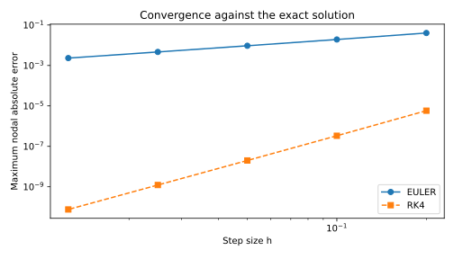

# Executed reference results

Python results were generated from the committed scripts with the versions in `results/python_environment.txt`. No random seed or external dataset is needed. CSV files retain more digits than the rounded table below.

| Method | h | Maximum nodal error | Observed order |
|---|---:|---:|---:|
| Euler | 0.2 | 4.01994e-2 | — |
| Euler | 0.1 | 1.92010e-2 | 1.0660 |
| Euler | 0.05 | 9.39352e-3 | 1.0314 |
| Euler | 0.025 | 4.64700e-3 | 1.0154 |
| Euler | 0.0125 | 2.31130e-3 | 1.0076 |
| RK4 | 0.2 | 5.79695e-6 | — |
| RK4 | 0.1 | 3.33241e-7 | 4.1207 |
| RK4 | 0.05 | 1.99761e-8 | 4.0602 |
| RK4 | 0.025 | 1.22274e-9 | 4.0301 |
| RK4 | 0.0125 | 7.56288e-11 | 4.0150 |

Halving the step approximately halves Euler's error and reduces RK4's error by a factor of 16. At h = 0.1, RK4 nearly overlaps the exact solution on the trajectory plot; the error table resolves the difference.

Four Python tests passed: analytic amplification factors, a nonautonomous exact solution, expected asymptotic orders, and invalid inputs. These checks validate the implemented scalar examples, not all possible right-hand sides.

MATLAB code was reviewed but not executed because MATLAB was unavailable. No MATLAB-generated results or cross-language agreement are claimed. `compare_results.py` compares actual generated trajectories with rtol=1e-11 and atol=1e-13, and small error values with rtol=1e-5 and atol=1e-14. Floating-point subtraction makes relative differences in very small errors larger than differences in trajectories.

The scripts overwrite only their own named result files. Generated MATLAB files are ignored by Git by default so local validation does not obscure the executed Python reference outputs.
